<div align="center">


<a href="https://github.com/sazid63">
  
</a>

<br/>


<a href="https://github.com/sazid63?tab=followers"></a>

<br/><br/>



</div>



## `> whoami`

<table>
<tr>
<td width="58%" valign="top">

I'm **Sajid**, a builder at **BUET** who likes making powerful tools easy to use.
Most of what I ship sits where **security, AI and automation** meet:

- 🛡️ **Cybersecurity**: a Kali-style workbench for Windows, a zero-cost home-network SOC, and local-first OSINT pipelines
- 🤖 **AI & automation**: AI-assisted dev environments with guardrails, agentic pipelines, and content autopilots
- 🔐 **Cryptography**: decoding historical ciphers like the *Copiale* cipher
- 🧮 **Software & web**: a calculus solver, a building-to-CAD estimator, grid trading bots, business sites, and a game or two
- ✍️ **Writing**: I write about AI and the internet on **Medium**, published in *Towards AI*

> *Security research should be authorized. Tools should be approachable. Data should stay local.*

</td>
<td width="42%" align="center" valign="middle">



</td>
</tr>
</table>


## `> ls ~/projects --featured`

<div align="center">

<a href="https://github.com/sazid63/KaliDesk"></a>
<a href="https://github.com/sazid63/OSINT-Workstation"></a>
<a href="https://github.com/sazid63/Opencode-Shield"></a>
<a href="https://github.com/sazid63/ArchPilot"></a>
<a href="https://github.com/sazid63/Symcalc"></a>
<a href="https://github.com/sazid63/Copiale-Translator"></a>

</div>

<details>
<summary><b>📂 More from the lab</b></summary>
<br/>

| Project | What it does |
|---|---|
| [**NIDS-Mini: Create Your Own AI**](https://github.com/sazid63/NIDS-Mini-Create-Your-Own-AI) | A beginner-friendly walkthrough of the whole process of building an AI model: a network intrusion detector. |
| [**GridBot**](https://github.com/sazid63/GridBot) | A custom grid trading bot designed for both bull and bear markets. |
| [**HandOfGOD**](https://github.com/sazid63/HandOfGOD) | A browser game for passing the time. Hurt feelings won't be reimbursed. |

</details>


## `> cat stack.json`

<div align="center">

<br/><br/>
<br/><br/>


<br/><br/>


</div>


## `> git log --graph --all`

<div align="center">

<!-- Contribution line graph -->


<br/>


<br/><br/>

<!-- Animated contribution calendar (the green squares, eaten by a snake). Generated by .github/workflows/snake.yml -->
<picture>
  <source media="(prefers-color-scheme: dark)" srcset="https://raw.githubusercontent.com/sazid63/sazid63/output/github-snake-dark.svg" />
  <source media="(prefers-color-scheme: light)" srcset="https://raw.githubusercontent.com/sazid63/sazid63/output/github-snake.svg" />
  
</picture>

</div>


## `> ./principles.sh`

```diff
+ [SEC]      Security research and testing should be authorized and responsible.
+ [BUILD]    Practical tools that make complex workflows easy.
+ [PRIVACY]  Local-first, transparent, privacy-conscious by default.
+ [AI]       Automate the boring parts, keep a human and a guardrail in the loop.
! [LEARN]    Keep learning. Keep shipping.
```


## `> tail -f ~/medium/latest.log`

<ul>
<!-- BLOG-POST-LIST:START --><li><a href="https://pub.towardsai.net/october-2026-the-month-ai-went-wild-and-the-internet-became-the-new-wild-west-304cb7f71383?source=rss-e6d8f75b5a5b------2">October 2026: The Month AI Went Wild — And the Internet Became the New Wild West</a> <sub>· Nov 16, 2026</sub></li>
<li><a href="https://pub.towardsai.net/inside-moltbook-what-a-social-network-for-ai-agents-really-tells-us-00beea633946?source=rss-e6d8f75b5a5b------2">Inside Moltbook: What a Social Network for AI Agents Really Tells Us</a> <sub>· Nov 13, 2026</sub></li>
<!-- BLOG-POST-LIST:END -->
</ul>

<sub>↻ Auto-updated from Medium by a GitHub Action.</sub>

## `> ping --connect`

<div align="center">

<a href="https://medium.com/@sajidhossain04"></a>
<a href="https://www.linkedin.com/in/sajid-hossain-386149236/"></a>
<a href="https://huggingface.co/sazid63"></a>
<a href="https://sazid63.netlify.app"></a>
<a href="https://github.com/sazid63?tab=repositories"></a>

<br/><br/>

<a href="https://medium.com/@sajidhossain04">
  
</a>


<sub>Stay curious. Build responsibly. Secure what matters.</sub>

</div>
